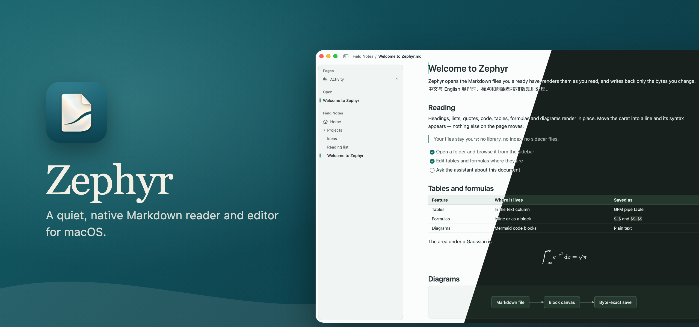
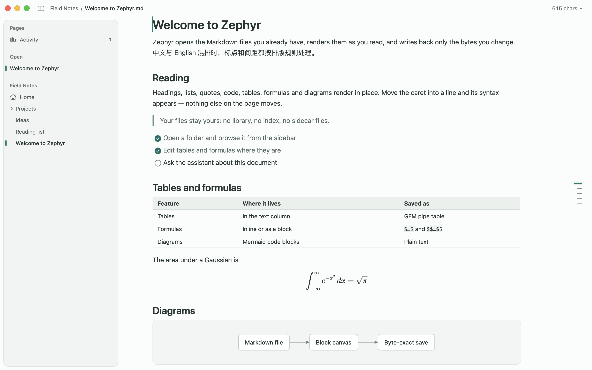
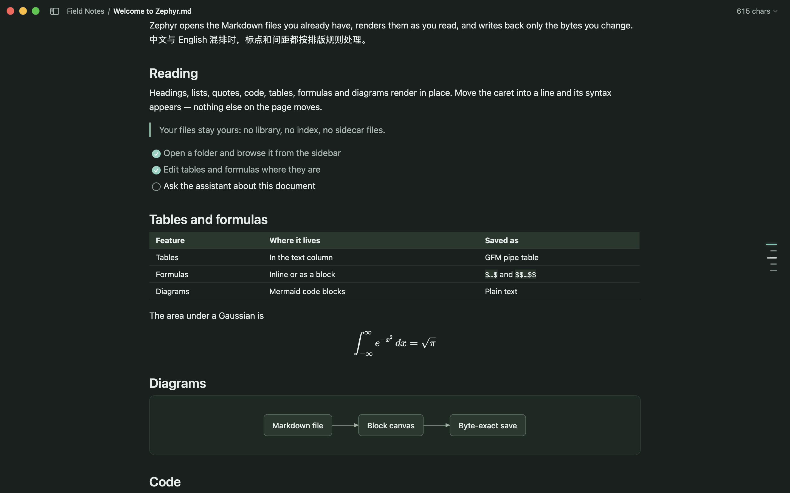

<p align="center">
  
</p>

<p align="center">
  <a href="https://github.com/W-ZN/Zephyr/releases/latest"></a>
  
  
  
  <a href="LICENSE"></a>
</p>

**Zephyr** opens the Markdown files you already have, renders them as you read, and writes back only the bytes you change. It is a native AppKit app with its own Core Text block canvas: no Electron, no web view for the document, no library or index in your folders.

> **Status: pre-alpha (v0.1.4).** The v1 feature set — reading, editing, the assistant with CLI/MCP access, customization — is implemented. Some performance targets and the full Quick Look matrix are still being verified.

<p align="center">
  
  
</p>

The [user guide](docs/guide.md) describes each part in detail.

## Install

1. Download **`Zephyr-0.1.4.dmg`** from the [latest release](https://github.com/W-ZN/Zephyr/releases/latest) and open it.
2. Drag **Zephyr.app** onto **Applications**.
3. **Sign it on your Mac (required).** Zephyr is not notarized by Apple: the project has no paid Apple Developer ID, so the release carries only an ad-hoc signature and macOS refuses to open the downloaded copy ("Apple could not verify…"). Open Terminal and run:

   ```bash
   xattr -dr com.apple.quarantine /Applications/Zephyr.app
   ```

   ```bash
   codesign --force --deep --preserve-metadata=entitlements,flags --sign - /Applications/Zephyr.app
   ```

   The first command removes the "downloaded from the internet" mark. The second signs the app ad-hoc on your own Mac, keeping its entitlements and those of its helpers. These steps apply to manual installations.

4. Open Zephyr from Applications.

**Requirements:** macOS 15 Sequoia or later, on Apple silicon or Intel (universal binary).

To check the download, compare `shasum -a 256 Zephyr-0.1.4.dmg` with the `.sha256` file attached to the release. If you prefer not to run a downloaded binary at all, [build it from source](#build-from-source) — it takes one command.

**Updates:** version 0.1.2 introduces signed updates from GitHub Releases. Install it manually once when upgrading from 0.1.1. **Settings → General → Updates** provides a manual check, daily checks, and optional automatic installation after quitting. Automatic installation is off by default. Updates replace the app bundle and keep your preferences and editable theme files in `~/Library/Application Support/Zephyr/`.

**Finder preview:** turn on Space-bar preview in **Zephyr → Settings → General → Documents**, where you can also make Zephyr the default Markdown editor.

## Build from source

Requires macOS 15 or later and Xcode 27 (Swift 6.4). No Apple developer account is needed.

```bash
git clone https://github.com/W-ZN/Zephyr.git
```

```bash
cd Zephyr && make build && open dist/Zephyr.app
```

`make build` fetches a pinned XcodeGen into `build.noindex/`, generates the Xcode project, builds Release and signs the app. Everything the build makes stays inside the checkout. `make test` runs the unit tests and `make dmg` makes the release disk image. See [CONTRIBUTING.md](CONTRIBUTING.md) for all checks, the repository layout and conventions.

## Agents, CLI and MCP

The app bundles a command-line tool at `Zephyr.app/Contents/Helpers/zephyr`. When you share a document with agents (**File → Allow Agent Access**), it can read the document as currently edited, search it or its folder, and propose edits that open a review sheet in Zephyr:

```bash
zephyr read --lines 1:40
zephyr propose --find "Monday" --replace "Friday" --summary "Move the date" --wait
```

`zephyr mcp` serves the same tools over MCP on stdio. **Settings → Agents** shows the exact path and a configuration to copy:

```json
{ "mcpServers": { "zephyr": { "command": "/Applications/Zephyr.app/Contents/Helpers/zephyr", "args": ["mcp"] } } }
```

## Privacy

Zephyr has no account, telemetry or analytics. Daily update checks contact GitHub Releases and can be disabled in Settings. Other network requests happen when a feature needs them: the assistant talks to the provider and endpoint you configure, with your own API key (stored encrypted by Zephyr in `~/Library/Application Support/Zephyr/`, readable only by you); link previews fetch the link you point at; an explicit page snapshot renders a URL in a nonpersistent web view; images a document links on the web (a README's badges, for example) load over HTTPS without cookies, unless you turn **Remote images** off in **Settings → General**. Static shields.io badges are drawn by Zephyr and need no request.

## Project layout

```text
sources/core      ZephyrCore — bytes, structure, search, edits, HTML subset, document tools, AI client, agent IPC (Foundation only)
sources/layout    ZephyrLayout — block layout core: units, prefix sums, height map, reading anchor (Foundation only)
sources/render    ZephyrRender — Core Text block canvas, components, theme, flat controls, printing
apps/macos        the AppKit app, Quick Look extension, zephyr CLI, XcodeGen spec, signing and packaging scripts
tests             unit tests per module, end-to-end checks through the built app, benchmarks, fixtures
docs              user guide and README images
```

## Documentation

- [User guide](docs/guide.md) — windows, pages, files, previews, export and agent access in detail
- [Contributing](CONTRIBUTING.md) — building, checks, repository layout and conventions

## License

Zephyr is released under the [MIT License](LICENSE). It is built with [swift-markdown](https://github.com/swiftlang/swift-markdown) (Apache 2.0), [swift-cmark](https://github.com/swiftlang/swift-cmark) (BSD 2-Clause), [SwaTex](https://github.com/PhraseHQ/SwaTex) (MIT, with the KaTeX fonts under the SIL Open Font License), and [Sparkle](https://sparkle-project.org/) (MIT); see [THIRD_PARTY_NOTICES.md](THIRD_PARTY_NOTICES.md).
