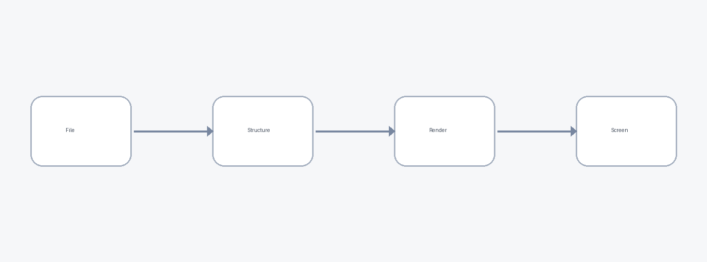

# Project Name

A short tagline with **emphasis** and `code`. 
  

Badges also sit in a line of text: version  on macOS  today.

Press <kbd>⌘</kbd><kbd>K</kbd> to search. Water is H2O, area is r2, and <mark>this is highlighted</mark>, <u>this underlined</u>, <small>this small</small>.

   
  Right-aligned with a line break and a <a href="#top">link</a>.

Details and a picture

<picture>
  <source media="(prefers-color-scheme: dark)" srcset="https://img.shields.io/badge/theme-dark-222">
  
</picture>
<blockquote>A quoted note inside HTML, with <em>emphasis</em>.</blockquote>

| Package | Status |
|---|---|
| core |  |
| render |  |

